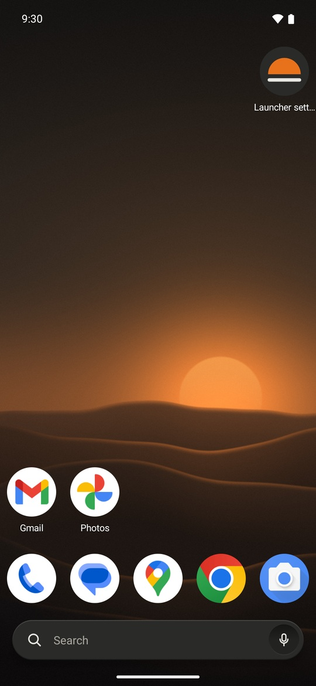
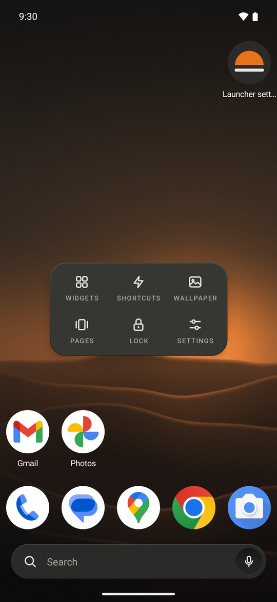
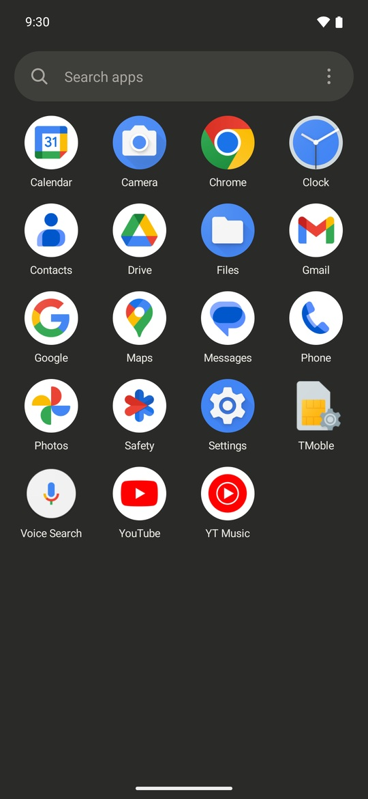
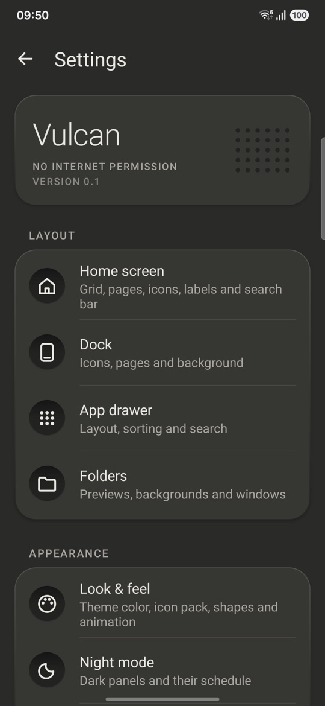
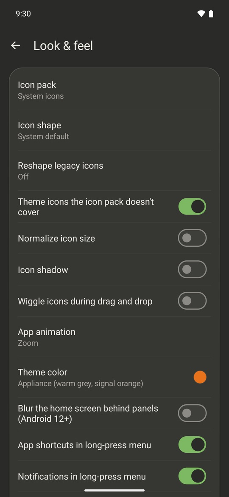

# Vulcan

A home screen for Android that does what Nova Launcher does, without ads, trackers or analytics.

**It has no internet access at all, so nothing it does can leave your phone.**

  
  
  
  
  

It looks like a well-made appliance rather than a phone skin: warm-grey panels (light or night), small printed labels, and one orange dot for whatever is live (the current page, the letter you're on). Your wallpaper and your apps' own icons are left alone. Every Nova-style option (icon packs, shapes, glass panels, wallpaper colours) is still in settings when you want it.

The wallpaper in these screenshots is [docs/wallpaper-dusk.jpg](docs/wallpaper-dusk.jpg), made for Vulcan. Use it freely.

## Install

Vulcan needs Android 8 or newer.

**[Download the latest APK](https://github.com/krishnanunnir/vulcan-launcher/releases/latest/download/vulcan-launcher.apk)** (about 0.15 MB), or see [all releases](https://github.com/krishnanunnir/vulcan-launcher/releases). F-Droid is on the way.

1. Open it on your phone and tap **Install**. Android may first ask you to allow installs from your browser or file manager.
2. Press the **Home** button. Android asks which home app to use: pick **Vulcan**, then **Always**.
3. To go back to your old home screen at any time, open your phone's **Settings → Apps → Default apps → Home app**.

## Coming from Nova?

You can bring your Nova home screen with you:

1. In Nova, open **Nova Settings → Backup & import settings → Backup** and save the file.
2. In Vulcan, long-press an empty spot on the home screen, then tap **Settings → Backup & restore → Import a launcher backup (.novabackup)…** and pick that file.

Your apps, folders, dock, grid size and most shortcuts come over. Widgets have to be added again.

## Design your home screen with an AI assistant

A Vulcan backup is a plain JSON file that explains itself, so you can hand it to an AI assistant (or edit it yourself) and load the result:

1. **Settings → Backup & restore → Back up to a file…** and save it.
2. Give the file to an assistant with a request like "make a calm two-page layout: messaging and maps in the dock, a Work folder, monochrome labels".
3. Load the edited file with **Settings → Backup & restore → Restore from a file…**.

The file starts with `howTo` (how the grid, dock and folders work), and `reference` lists every setting with its allowed values, every gesture action, and the apps installed on your phone. The file also holds your drawer tabs and folders, hidden apps and renamed apps. Values Vulcan can't use are skipped and named when you restore. The assistant never needs to reach your phone: you move the file yourself.

## What you can do

- **Arrange your home screen your way:** grids up to 12 by 12, up to 9 pages, resizable widgets, and a dock you can hide or scroll.
- **Find apps fast:** an A to Z app drawer with the search bar at the bottom, a letter index down the side, and tabs or folders to group apps. Hide the apps you don't want to see.
- **Use gestures:** swipe, double-tap or pinch on the home screen to open notifications, an app, the app drawer, the screen lock and more. Each app icon can have its own swipe-up action too.
- **Change the look:** icon packs, icon shapes, your own icons and labels, folder styles, and a night mode that follows the system or a schedule.
- **Long-press an app** for its shortcuts, notifications, app info or uninstall.
- **Swipe right on the first page** for the Now page: the date, music controls, upcoming events and favourite contacts.
- **Back up** your whole setup to a file and restore it later.

Long-press an empty spot on the home screen to open **Settings**. The full feature list, compared with Nova's, is in [ROADMAP.md](ROADMAP.md).

## Compared with Nova

Nova Launcher changed owners in 2022 and again in January 2026, and picked up ads and trackers along the way. This is what the current version contains:

| | Nova Launcher 8.9.4 | Vulcan |
|---|---|---|
| **Internet access** | Yes | None. It can't send anything. |
| **Activity log** | Records the Wi-Fi networks you join, Bluetooth devices (name and hardware address), every app you open from the home screen, app usage, and apps you install or remove. Uploaded to Nova's server every 8 hours. | Nothing is recorded or sent. |
| **Opting out of the log** | No setting for it was found. | Nothing to opt out of. |
| **Analytics and tracking** | Firebase, Sentry, Amplitude, TikTok and Branch. | None. |
| **Ads** | Six ad networks (Pangle, Vungle, Moloco, Fyber, Meta, AdMob), chosen by Nova's server. Not shown to Prime users. | None. |
| **AI features** | Instabridge AI can collect contacts, calendar, location, apps, Wi-Fi and Bluetooth and sync them to its server, if you agree. | None. Contacts and calendar are only read on the phone, and only if you turn those cards on. |
| **Source code** | Closed. | Public, under the MIT license. |

The Nova column comes from reading the code of the Nova Launcher 8.9.4 app (October 2026) without running it, so it shows what the app contains, not what it sent from any one phone. [docs/nova-reference.md](docs/nova-reference.md) has the details.

## Privacy and permissions

Vulcan has no internet permission, so it can't send anything anywhere. There are no ads, analytics or crash reports. Anyone can check the permission list of the APK.

Most permissions below stay **off until you turn on the feature that needs them**, and Vulcan says why when it asks.

| What it's for | When it's used | Android permission |
|---|---|---|
| Opening the notification shade or quick settings with a gesture (swipe down, by default). | Always available. Granted at install. | `EXPAND_STATUS_BAR` |
| **Uninstall** in an app's long-press menu. It only opens Android's own uninstall prompt, which you confirm. | Always available. Granted at install. | `REQUEST_DELETE_PACKAGES` |
| **Close app** in the long-press menu. Android only lets it stop an app's background work. | Always available. Granted at install. | `KILL_BACKGROUND_PROCESSES` |
| Notification dots and counts on icons, notifications in the long-press menu, and music controls on the Now page. Notifications are counted in memory and never saved. | **Off** until you turn it on in Settings → Permissions. | Notification access (`BIND_NOTIFICATION_LISTENER_SERVICE`) |
| Searching your contacts from the app drawer, and favourite contacts on the Now page. | Asked only when you turn one of those on. | `READ_CONTACTS` |
| Upcoming events on the Now page. | Asked only when you turn it on. | `READ_CALENDAR` |
| "Sunset to sunrise" night mode. It uses the last location your phone already knows and works out the sun times on the phone. | Asked only when you pick that mode. | `ACCESS_COARSE_LOCATION` |
| The screen lock, recent apps and power menu gestures (Android offers no other way). It can't read anything on your screen. | **Off** until you turn it on. | Accessibility service (`BIND_ACCESSIBILITY_SERVICE`, `canRetrieveWindowContent="false"`) |
| Hiding the status bar clock on the home screen. Apps can't give themselves this: you grant it once from a computer with `adb shell pm grant dev.vulcanlauncher android.permission.WRITE_SECURE_SETTINGS`. Vulcan only adds or removes the clock in the status bar. | Only if you grant it. Most people never need it. | `WRITE_SECURE_SETTINGS` |

Nothing else, and no `INTERNET`. App shortcuts need Vulcan to be your default home app, which is your choice rather than a permission. The `<queries>` entries in the manifest (launcher apps, icon packs, shortcut creators, voice and web search) only let Vulcan see those apps. Any new permission must be added to this table (see [CLAUDE.md](CLAUDE.md)).

## For developers

Vulcan is written from scratch in Kotlin, with no libraries and no Nova code. [docs/BUILDING.md](docs/BUILDING.md) has the build steps, the on-device checks, and links to the roadmap and architecture notes.

## Translating

Every word Vulcan shows is in [`app/src/main/res/values/strings.xml`](app/src/main/res/values/strings.xml) (English). To add a language, copy it to `values-<code>/strings.xml` (for example `values-de` for German) and translate the text between the tags. Leave the `name` attributes and placeholders such as `%1$s` and `%1$d` as they are; a string you leave out shows in English. Anything marked `translatable="false"` stays as it is. The unit tests check that every translated name and placeholder matches the English file.

The settings' stored values, your layout and backup files don't depend on the language, so switching languages changes nothing else. The explanation inside a backup file (`howTo`) stays in English; it's written for whoever edits the file.

## License

[MIT](LICENSE).
